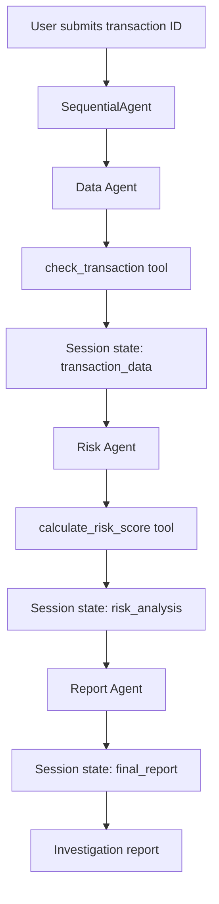

# Multi-Agent Fraud Detection with Google ADK

An educational Python project demonstrating a three-agent fraud investigation workflow using **Google Agent Development Kit (ADK)**, Gemini, custom Python tools, and shared session state.

> **Disclaimer:** This prototype uses fictional transactions and demonstration scoring rules. It is not a production fraud detection system and should not be used to make financial decisions.

## Architecture



The `SequentialAgent` executes its child agents in order: **Data → Risk → Report**. Each `LlmAgent` can use its assigned tools and write its final response to session state with `output_key`.

## Features

- Three specialized agents coordinated by `SequentialAgent`
- Transaction lookup using a custom Python function tool
- Deterministic, rule-based fraud scoring
- Agent-to-agent information passing via ADK session state
- Local testing with the ADK web UI, CLI, or Python `Runner`
- Event inspection for tool calls, tool responses, and final outputs

## Tech Stack

- Python 3.12
- Google ADK (`google-adk`)
- Gemini (`gemini-2.5-flash` in the examples; requires model access)
- `python-dotenv`
- `InMemorySessionService` for local development

## Project Structure

```text
fraud-adk/
├── fraud_agent/
│   ├── __init__.py
│   ├── agent.py        # Root SequentialAgent
│   ├── agents.py       # Data, Risk, and Report agents
│   ├── data.py         # Synthetic transaction records
│   ├── tools.py        # Lookup and scoring functions
│   └── .env            # Local API configuration (do not commit)
├── main.py             # Programmatic Runner and event inspection
├── requirements.txt
├── .gitignore
└── README.md
```

## Installation

### 1. Clone the repository

```bash
git clone https://github.com/nargesghv/fraud_agent.git
cd fraud_agent
```

Make sure the repository root contains the `fraud_agent/` package shown above.

### 2. Create and activate a virtual environment

On Windows PowerShell:

```powershell
python -m venv .venv
.\.venv\Scripts\Activate.ps1
```

### 3. Install dependencies

```powershell
pip install -r requirements.txt
```

Example `requirements.txt`:

```text
google-adk
python-dotenv
```

### 4. Configure the Gemini API

Create `fraud_agent/.env`:

```dotenv
GOOGLE_GENAI_USE_VERTEXAI=FALSE
GOOGLE_API_KEY=YOUR_GEMINI_API_KEY
```

Get an API key from [Google AI Studio](https://aistudio.google.com/). Add `.env` and `.venv/` to `.gitignore` and never commit API keys.

## Running the Project

Run the following commands from the project root.

### ADK web interface

```powershell
adk web
```

Open the local URL shown in the terminal (typically <http://127.0.0.1:8000>) and select `fraud_agent`.

### ADK terminal interface

```powershell
adk run fraud_agent
```

### Python Runner

```powershell
python main.py
```

`main.py` creates an in-memory session, executes the root agent with `Runner.run_async()`, and prints events and session state. If running programmatically, load the `.env` configuration before creating the agent or Runner.

## Agent Responsibilities

| Agent | Responsibility | Tool | Output key |
|---|---|---|---|
| Data Agent | Retrieve transaction evidence | `check_transaction` | `transaction_data` |
| Risk Agent | Score a transaction and explain indicators | `calculate_risk_score` | `risk_analysis` |
| Report Agent | Summarize evidence and next investigation steps | None | `final_report` |

### Sharing data between agents

The Data Agent saves its final response using:

```python
output_key="transaction_data"
```

The Risk Agent can reference it in its instructions:

```python
instruction="""
Review the transaction evidence:
{transaction_data}
"""
```

`output_key` normally stores the agent's **final text response**, not an automatically validated Python dictionary. The scoring tool independently reads the stored transaction by ID so the LLM does not supply authoritative scoring inputs.

## Demonstration Fraud Scoring

| Indicator | Condition | Points |
|---|---|---:|
| Large amount | Amount > $10,000 | +30 |
| Failed attempts | 3 or more | +35 |
| Country mismatch | Transaction country differs from usual country | +35 |

**Risk levels:** Low = 0–34; Medium = 35–69; High = 70–100.

| Transaction | Amount (USD) | Score | Risk level |
|---|---:|---:|---|
| TX1001 | $120 | 0 | Low |
| TX1002 | $18,000 | 100 | High |
| TX1003 | $450 | 35 | Medium |

These are fictional examples. The score is computed by deterministic Python code, not generated by the LLM.

## Example Prompt

```text
Investigate transaction TX1002 and prepare a fraud investigation report.
```

Expected workflow:

1. Data Agent calls `check_transaction("TX1002")`.
2. Risk Agent calls `calculate_risk_score("TX1002")`.
3. Report Agent summarizes the transaction, returned score, indicators, and recommended investigation steps.

The **agent order** is fixed, but individual LLM tool calls are guided by instructions rather than guaranteed by `SequentialAgent` itself.

## Key ADK Concepts

- **`LlmAgent`:** A Gemini-powered agent with instructions and optional tools.
- **`SequentialAgent`:** A workflow controller that runs child agents in order.
- **`Runner`:** Executes the agent application and emits events.
- **`SessionService`:** Stores conversation events and session state.
- **`output_key`:** Writes an agent's final response into session state.
- **`ToolContext`:** Gives tools access to execution context, including state.
- **Events:** Allow inspection of tool calls, responses, and final outputs.

## Limitations

- Transactions are held in a Python dictionary, not a database.
- Scoring thresholds are educational examples, not validated fraud models.
- Tool calls depend on LLM behavior.
- A missing transaction does not automatically stop the sequential workflow.
- In-memory sessions are not durable across restarts.
- Production authentication, audit logging, security controls, and evaluations are not implemented.

## Roadmap

- [x] Single-agent prototype and custom function tools
- [x] Runner, sessions, events, and state
- [x] Sequential Data → Risk → Report workflow
- [ ] Parallel fraud analysis with `ParallelAgent`
- [ ] Iterative review with `LoopAgent`
- [ ] Conditional routing and graph workflows
- [ ] PostgreSQL transaction storage
- [ ] Graph-based fraud relationship analysis
- [ ] Machine-learning fraud scoring
- [ ] MCP integration
- [ ] A2A communication
- [ ] Automated tests, evaluations, and audit logs
- [ ] FastAPI, Docker, and cloud deployment

## References

- [Google ADK](https://adk.dev/)
- [Google ADK Tutorials](https://adk.dev/tutorials/)
- [Google Cloud Agentic AI Design Patterns](https://docs.cloud.google.com/architecture/choose-design-pattern-agentic-ai-system)
- [Model Context Protocol](https://modelcontextprotocol.io/)
- [Agent2Agent Protocol](https://a2a-protocol.org/latest/)

## License

No license has been specified for this repository.
